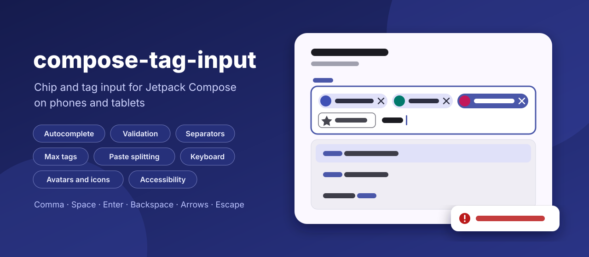
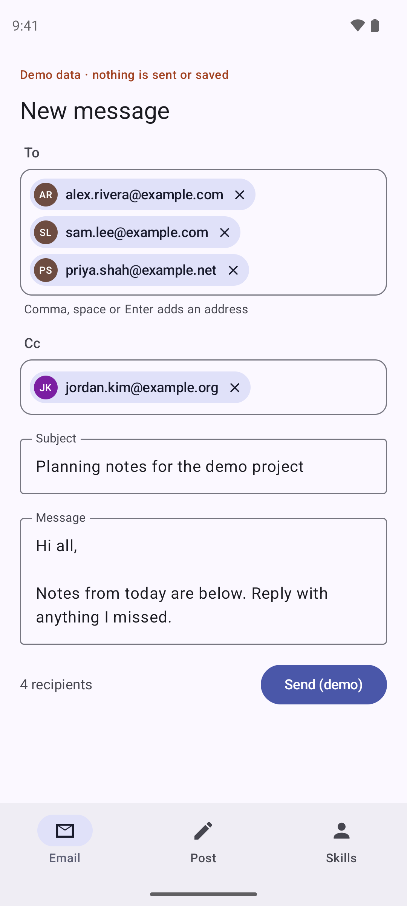
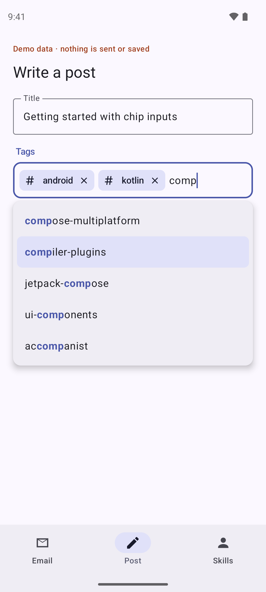
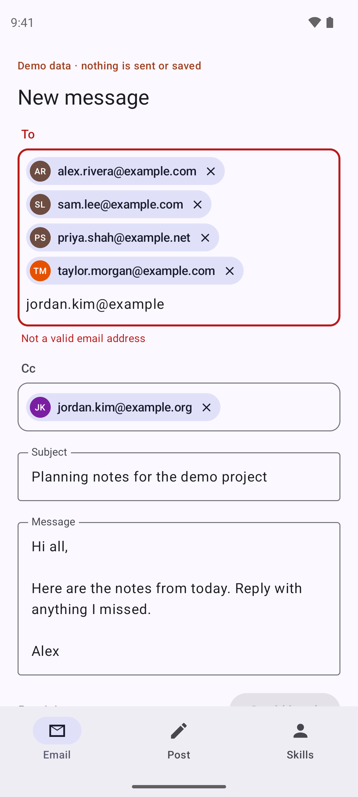
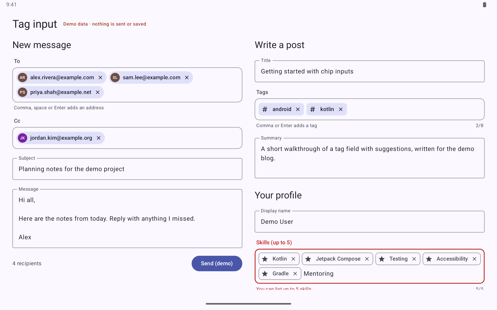

<p align="center">
  
</p>

<p align="center">
  <a href="https://github.com/halilozel1903/compose-tag-input/actions/workflows/ci.yml"></a>
  <a href="https://jitpack.io/#halilozel1903/compose-tag-input"></a>
  
  
  
  
  <a href="LICENSE"></a>
</p>

**compose-tag-input** is a chip and tag input for Jetpack Compose: email recipients, blog tags, skills, labels, filters. Tags flow inline as chips, followed by the text field. A comma, a space, Enter or your own separator commits the text, and a paste is split into many tags. Backspace in an empty field selects the last chip and a second Backspace removes it. A suggestion list highlights the matched part and follows the arrow keys. A validator, a duplicate policy and a tag limit refuse text with an error message under the field. Chips can be filled or outlined, with an avatar or an icon. The state survives rotation and process death, and every chip is announced to TalkBack with its position and a Remove action. The rules live in a small pure Kotlin module with unit tests.

```kotlin
val recipients = rememberTagInputState(
    config = TagInputConfig(validator = TagValidators.email()),
)

TagInput(
    state = recipients,
    suggestions = contacts,                      // filtered as you type, matches highlighted
    label = "To",
    placeholder = "Add recipients",
    chipShape = TagInputDefaults.PillShape,
    chipLeading = { tag -> TagAvatar(tag.text) },
    keyboardType = KeyboardType.Email,
)

Button(onClick = { send(recipients.tagTexts) }, enabled = recipients.tags.isNotEmpty()) { Text("Send") }
```

## Screenshots

CI captures these from the sample app on Android emulators. **All content in the sample is demo data bundled with the app:** made-up names at the reserved `example.com`, `example.org` and `example.net` domains, generic blog topics and a "Demo User" profile. Nothing comes from or is sent to a real person or service. The scenes type into the fields through the library's public API, the same way a user would.

| Email recipients | Suggestions | Validation |
| :---: | :---: | :---: |
|  |  |  |

**Tablet:** on a Pixel Tablet in landscape the three forms sit side by side. The skills field is full at 5 of 5, and a sixth pasted skill stays in the field with the limit message.



## Features

- **Chips inline with the text field.** The field takes the rest of the last line and moves to a line of its own when the space left is too narrow for what you type.
- **Separators.** Comma and space by default. Pass any set (`setOf(',', ';')`), or an empty set so only Enter commits. Enter and the keyboard's Done action commit too (`commitOnEnter`), and so does leaving the field (`commitOnFocusLoss`).
- **Paste splitting.** Pasted text is split on the separators and always on new lines and tabs, so a column of addresses becomes one tag per line.
- **Validation.** `TagValidators.email()`, `maxLength(n)`, `pattern(regex, message)` and `allOf(...)`, or your own `TagValidator`. Refused text stays in the field, so nothing typed or pasted is lost, and the error shows under the field and is announced.
- **Duplicates.** `DuplicatePolicy.RejectIgnoreCase` (default), `Reject` or `Allow`. Duplicates are dropped with a message.
- **Max tags.** `maxTags = 5` shows a `3/5` counter and refuses more with a message.
- **Transform.** Normalize tags as they are added, for example `{ it.lowercase().replace(' ', '-') }`.
- **Suggestions.** Matches that start with the text come first, then matches at a word start, then the rest, with the matched part in bold. Tags already added are left out. The list is a popup that never takes focus, so the keyboard stays up.
- **Keyboard handling.** Backspace selects the last chip and then removes it. Left and Right walk the chips, Delete removes the selected one. Up and Down move the suggestion highlight, Enter or Tab picks it, Escape closes the list or clears the selection.
- **Chip styles.** `TagChipStyle.Filled` or `Outlined`, any shape, an avatar with initials (`TagAvatar`) or an icon (`TagIcon`) in front. `TagChip` works on its own too.
- **Saveable state.** Tags (with their ids), text and selection survive configuration changes and process death.
- **Accessibility.** Each chip is one node, such as "kotlin, tag 2 of 5", with its selection and a Remove action. The field reports its count ("3 of 5 tags") and its error, and suggestions report their position. All strings can be translated with `TagInputDescriptions`.
- **Pure Kotlin core** (`compose-tag-input-core`) with every rule above as functions on an immutable snapshot, all unit tested.

## Installation

Add JitPack to `settings.gradle.kts`:

```kotlin
dependencyResolutionManagement {
    repositories {
        google()
        mavenCentral()
        maven("https://jitpack.io")
    }
}
```

Then add the dependency:

```kotlin
dependencies {
    implementation("com.github.halilozel1903.compose-tag-input:compose-tag-input:1.0.0")

    // Pure Kotlin logic only (splitting, validation, suggestions, layout math):
    // implementation("com.github.halilozel1903.compose-tag-input:compose-tag-input-core:1.0.0")
}
```

> The build is also set up for Maven Central (`io.github.halilozel1903:compose-tag-input`) through the vanniktech publish plugin.

## Usage

**Blog tags with suggestions**

```kotlin
val tags = rememberTagInputState(
    initialTags = listOf("android"),
    config = TagInputConfig(
        separators = setOf(','),                         // spaces are allowed inside a tag...
        transform = { it.lowercase().replace(' ', '-') }, // ...and become dashes
        validator = TagValidators.pattern(Regex("[a-z0-9-]+"), "Use letters, digits and dashes"),
        maxTags = 8,
    ),
)

TagInput(
    state = tags,
    suggestions = listOf("kotlin", "jetpack-compose", "compose-multiplatform", "coroutines"),
    label = "Tags",
    supportingText = "Comma or Enter adds a tag",
    chipLeading = { TagIcon(TagIcons.Hash) },
)
```

**Skills, at most five, outlined**

```kotlin
val skills = rememberTagInputState(
    config = TagInputConfig(separators = setOf(',', ';'), maxTags = 5),
)

TagInput(
    state = skills,
    suggestions = allSkills,
    label = "Skills",
    chipStyle = TagChipStyle.Outlined,
    chipLeading = { TagIcon(TagIcons.Star) },
    errorText = { error ->
        if (error is TagError.LimitReached) "You can list up to ${error.max} skills" else error.defaultMessage
    },
)
```

**Changing tags from code**

```kotlin
state.add("kotlin")              // same checks as typing; returns whether it was added
state.addAll(imported)           // returns how many were added
state.setText("a, b, c")         // as if typed or pasted: commits a and b, leaves c
state.removeAt(0)
state.clear()
state.error                      // TagError.Invalid, Duplicate or LimitReached, or null
```

### `TagInput` parameters

| Parameter | Default | What it does |
| --- | --- | --- |
| `state` | | `rememberTagInputState(initialTags, config)` |
| `suggestions` | empty | Offered while typing; tags already added are left out |
| `label`, `placeholder`, `supportingText` | `null` | Texts above, inside and under the field |
| `enabled` | `true` | Read-only field and no remove buttons when false |
| `chipStyle` | `Filled` | `Filled` or `Outlined` |
| `chipShape` | `ChipShape` | `TagInputDefaults.ChipShape` (8 dp) or `PillShape` |
| `chipColors`, `colors` | from the theme | `TagInputDefaults.chipColors(style)`, `TagInputDefaults.colors()` |
| `chipLeading` | `null` | `@Composable (Tag) -> Unit`, such as `TagAvatar(it.text)` or `TagIcon(icon)` |
| `showCounter` | `true` | `3/5` under the field when there is a limit |
| `minQueryLength` | `1` | Characters before suggestions show; `0` shows them on focus |
| `maxSuggestions` | `6` | The most suggestions shown |
| `commitOnFocusLoss` | `true` | Commits the text when the field loses focus |
| `keyboardType` | `Text` | The soft keyboard, such as `KeyboardType.Email` |
| `errorText` | English | `(TagError) -> String` |
| `descriptions` | English | `TagInputDescriptions`: what TalkBack says |

### `TagInputConfig`

| Property | Default | What it does |
| --- | --- | --- |
| `separators` | `,` and space | Characters that commit; new lines and tabs always split a paste |
| `commitOnEnter` | `true` | Enter and Done commit the text |
| `maxTags` | no limit | The most tags |
| `duplicates` | `RejectIgnoreCase` | `Allow`, `Reject` or `RejectIgnoreCase` |
| `validator` | `null` | A `TagValidator` returning an error message or `null` |
| `transform` | none | Turns trimmed text into the tag's text |

### `TagInputState`

| Member | What it does |
| --- | --- |
| `tags`, `tagTexts`, `text` | The committed tags (with stable `id`s), their texts, and the text not committed yet |
| `error`, `selectedIndex`, `highlightedIndex`, `isFull` | What the input shows right now |
| `add`, `addAll`, `remove`, `removeAt`, `clear` | Change the tags with the same checks as typing |
| `setText`, `commit` | Type or commit text from code |
| `select`, `moveHighlight`, `acceptSuggestion`, `dismissSuggestions`, `clearError` | Drive the selection, suggestions and error |
| `requestFocus` | Focus the text field |
| `snapshot`, `config` | The whole immutable `TagInputSnapshot` and the rules |

## Keyboard

| Key | Empty field | With text |
| --- | --- | --- |
| Separator, Enter | | Commits the text (Enter picks the highlighted suggestion instead) |
| Backspace | Selects the last chip, then removes it | Deletes a character |
| Delete | Removes the selected chip | Deletes a character |
| Left, Right | Walk the chips; Right past the last one returns to the field | Move the cursor |
| Up, Down | | Move the suggestion highlight, wrapping around |
| Tab | | Picks the highlighted suggestion; otherwise moves focus |
| Escape | Clears the chip selection | Closes the suggestion list until you type again |

## The core module

`compose-tag-input-core` doesn't depend on Android or Compose. Every rule is a function from one `TagInputSnapshot` to the next, so you can test your config or reuse it in another UI toolkit:

```kotlin
val config = TagInputConfig(validator = TagValidators.email())
var s = TagInputSnapshot()
s = TagInputLogic.onTextChange(s, "alex@example.com, nope,", config)
s.tagTexts                                     // [alex@example.com]
s.text                                         // "nope" (kept in the field)
s.error                                        // Invalid("nope", "Not a valid email address")
s = TagInputLogic.onBackspace(s.copy(text = ""))!!   // selects the last chip
TagSuggestions.filter(topics, "comp")          // prefix matches, then word starts, with match ranges
ChipFlowMath.arrange(listOf(100, 100), fieldMinWidth = 80, maxWidth = 400, spacing = 10)  // field at 220, 180 wide
TagAvatars.initials("alex.rivera@example.com") // "AR"
```

| API | What it does |
| --- | --- |
| `TagInputLogic` | Text changes, commit, Enter, Backspace, Delete, arrows, Escape, suggestions, add and remove |
| `TagSplitter` | Separators, paste splitting and the piece being typed |
| `TagValidators`, `TagValidator`, `DuplicatePolicy`, `TagError` | Checks and why text was refused |
| `TagSuggestions`, `SuggestionMatch` | Filtering, ranking and match ranges |
| `ChipFlowMath` | Where chips and the field go |
| `TagAvatars` | Initials and a stable color slot |
| `TagInputDescriptions` | Accessibility strings, translatable |

## Sample app

The `sample` module has three forms, all built from **demo data** in [`DemoData.kt`](sample/src/main/kotlin/io/github/halilozel1903/taginput/sample/DemoData.kt):

- **Email**: To and Cc fields with the email validator, avatar chips and contact suggestions.
- **Post**: lowercase, dashed blog tags with a hash icon, topic suggestions and a pattern validator. Only comma and Enter commit.
- **Skills**: at most five outlined skills with a star icon, with a semicolon as an extra separator.

Phones get a bottom navigation bar. Screens 840 dp and wider show all three forms side by side. The sample opens a scene from an intent extra, which `scripts/screenshots.sh` uses:

```bash
./gradlew :sample:installDebug
adb shell am start -n io.github.halilozel1903.taginput.sample/.MainActivity --es scene suggestions
```

`scene` is one of `recipients`, `suggestions`, `validation` or `tablet-form`. Each scene logs `SCENE_READY <scene>` once it has settled, or `SCENE_FAILED` when the field did not reach the expected state. CI waits for that line, captures the phone scenes on a Pixel 7 and `tablet-form` on a Pixel Tablet in landscape, and checks each capture for the screen's text and for blank images.

## Project structure

| Module | What it is |
| --- | --- |
| `tag-input-core` | Pure Kotlin: splitting, validation, duplicates, limits, selection, suggestions, flow math. Published as `compose-tag-input-core` |
| `tag-input` | Compose: `TagInput`, `TagChip`, `TagAvatar`, `TagInputState`. Published as `compose-tag-input` |
| `sample` | Three demo forms with screenshot scenes |

## Tech stack

Kotlin 2.4 · AGP 9.4 with built-in Kotlin · Gradle 9.6 · Jetpack Compose (BOM 2026.09) and Material 3 · a custom flow `Layout`, `BasicTextField` and a non-focusable `Popup` · GitHub Actions with Android emulators

## License

MIT. See [LICENSE](LICENSE).
